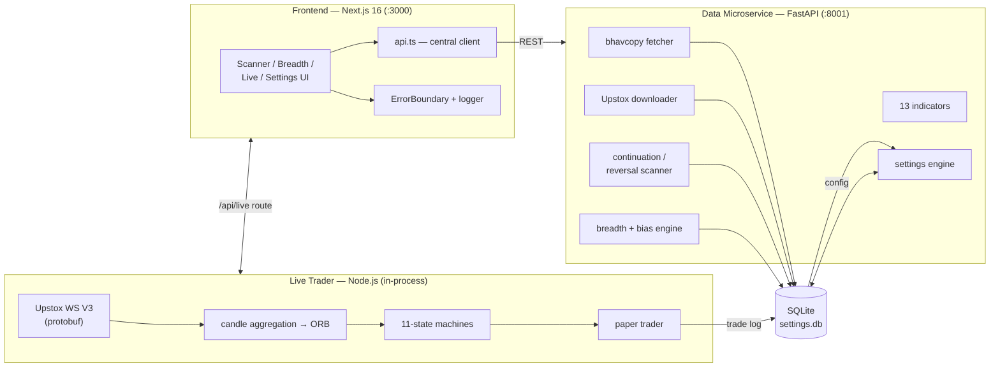

# TradeStack

Systematic NSE equity swing trading system — continuation & reversal scanners, live paper trader, market breadth analysis.

Scans 2000+ Indian stocks for technical patterns, streams live Upstox market data via WebSocket, and runs state-machine-driven paper trading. Built as a modern tri-partite architecture with a SQLite-shared state layer.

---

## Features

- **Data Pipeline** — NSE bhavcopy fetcher + Upstox historical downloader → per-stock `.pkl` cache backed by a SQLite index for instant stats
- **13 Technical Indicators** — SMA20, ADR%, MA angle, price change, volume surge, base filters, and more
- **Continuation Scanner** — 3-phase zig-zag pullback pattern detection (above MA → pullback below MA → recovery)
- **Reversal Scanner** — Decline-recovery pattern detection with trend classification (uptrend/downtrend)
- **Market Breadth** — 8 metrics per trading day plus a rule-based daily bias engine (REVERSALS / BREAKOUT / EASY DAY overlays)
- **Settings Engine** — 70 configurable parameters across 15 categories, all editable from the UI (no file editing)
- **Live Trader** — Upstox WebSocket V3 streamer, 11-state finite state machines for reversal & continuation modes, in-memory paper trader
- **Trade Logs** — SQLite-backed with CRUD API, auto P&L calculation, GitHub-style activity heatmap
- **Scanner Chart View** — Split-pane candlestick charts (lightweight-charts) with keyboard navigation

---

## Architecture

```
┌───────────────────────────────┐         ┌─────────────────────────────────┐
│  Frontend (Next.js 16)        │  HTTP   │  Data Microservice (FastAPI)    │
│  :3000                        │ ──────► │  :8001                          │
│                               │         │                                 │
│  • UI: scanner, breadth,      │         │  • bhavcopy fetcher             │
│    settings, live dashboard   │         │  • Upstox historical downloader │
│  • ErrorBoundary + structured │         │  • 13 indicators (pandas)       │
│    logger                     │         │  • continuation/reversal scans  │
│  • central api.ts client      │         │  • market breadth + bias engine │
│                               │         │  • settings engine (70 params)  │
└──────────────┬────────────────┘         └───────────────┬─────────────────┘
               │  in-process via /api/live                │
               ▼                                          ▼
┌──────────────────────────────┐          ┌───────────────────────────────┐
│  Live Trader (Node.js)       │          │  SQLite  data/settings.db     │
│  Upstox WS V3 (protobuf)     │          │  • settings + categories      │
│  11-state machines (R + C)   │  writes  │  • stock list / watchlist     │
│  candle aggregation → ORB    │ ───────► │  • trade log (auto P&L)       │
│  paper trader → trade log    │          │  • cache index + token vault  │
└──────────────────────────────┘          └───────────────────────────────┘
```

<details>
<summary>Mermaid version (renders on GitHub)</summary>



</details>

**Key principle:** Python does data. Node.js does live events. They share a single SQLite database. All config lives in the database, not in source files.

---

## Tech Stack (and why)

| Layer | Choice | Why |
|-------|--------|-----|
| Frontend | Next.js 16.2.7 (App Router), React 19 | App Router server routes host the live trader in-process — no extra service to deploy |
| UI | MUI v9 + Tailwind 4 | Dark theme tokens + fast utility styling for the terminal-style components |
| Charts | lightweight-charts 5.2 | Tiny, fast candlestick rendering with keyboard-navigable split panes |
| Live data | `ws` + protobufjs (Upstox WS V3) | SDK wraps the same socket anyway; protobuf decoding keeps tick processing cheap |
| Data service | FastAPI + pandas/numpy | Vectorized indicator math; async background tasks for long downloads |
| State | SQLite (WAL) | Single-file, zero-ops shared store for config, trade logs, cache index |
| Tooling | bun, TypeScript 5, pytest, vitest | Fast installs; dual-stack test suites mirror the dual-stack runtime |

---

## Getting Started

```powershell
git clone <repo-url>
cd TradeStack

# Install Node.js dependencies (uses bun)
bun install
cd frontend
bun install
cd ..

# Set up Python backend
cd backend
python -m venv venv
.\venv\Scripts\pip install -r requirements.txt
cd ..

# Configure the frontend backend URL (optional; defaults to localhost:8001)
copy frontend\.env.example frontend\.env.local

# Set up your Upstox token later from the UI (Live Trading → Token tab)

# Start both servers
bun run dev
```

- **Frontend:** http://localhost:3000
- **Backend health:** http://localhost:8001/health → `{"status":"healthy"}`

Server logs: `data/logs/backend.log` (rotating, 2 MB × 3).

---

## Commands

| Task | Command (repo root unless noted) |
|------|----------------------------------|
| Start both servers | `bun run dev` |
| Backend unit tests | `backend\venv\Scripts\python.exe -m pytest tests` |
| Frontend unit tests | `cd frontend && bun run test` (vitest) |
| Frontend typecheck | `cd frontend && bunx tsc --noEmit` |
| Frontend lint | `cd frontend && bun run lint` |
| Frontend production build | `cd frontend && bun run build` |
| Backend import smoke | `cd backend && .\venv\Scripts\python.exe -c "import sys; sys.path.insert(0,'.'); import server"` |

Backend env overrides (useful for tests/CI): `TRADESTACK_DB_PATH` (alternate SQLite file), `TRADESTACK_LOGS_DIR` (alternate log directory). Frontend: `NEXT_PUBLIC_PY_API` (browser-side backend URL), `PY_API_INTERNAL` (server-side URL, e.g. `http://backend:8001` under Docker).

---

## End-to-End Data Flow

1. **Data in** — *Scanner → Cache Data* tab: "Update Bhavcopy" (NSE EOD) or "Download Historical" (Upstox, ~180 calendar days/stock) run as tracked background operations (`/api/data/update-bhavcopy` → progress polling). Each write goes `cache/<SYMBOL>.pkl` → SQLite `cache_index` upsert.
2. **Scanning** — Scanner pages call `/api/scan/continuation` / `/api/scan/reversal`; the backend loads cached DataFrames, computes 13 indicators, applies pattern + base filters, and returns typed rows the UI renders (charts via `/api/stock/data`).
3. **Loading to live** — "Send to Live Trading" POSTs the scanner result to `/api/live` (`load` action); the Next.js route resolves symbols → Upstox instrument keys (`POST /api/instrument-keys`, ISIN format) and seeds the orchestrator's monitors.
4. **Live loop** — Orchestrator (`src/lib/live-trader/`) starts the pre-market flow (market-status + 3-stock token sanity), waits for market open, validates gaps at prep time, freezes ORB at entry time, then drives each stock's 11-state machine off WebSocket ticks. Entry/exit decisions append to the paper trader and the terminal log (structured entries: timestamp, message, severity).
5. **State out** — UI polls `GET /api/live?mode=…` (status + logs) and subscribes to SSE `/api/live/events` for instant log lines; entries/exits persist via Python `/api/trades/log-entry` → SQLite `trade_log` with auto P&L.
6. **Review** — Trade Logs tab shows the ledger, heatmap and cumulative stats; Market Breadth shows daily metrics + `compute_daily_bias` REVERSALS/overlays for go/no-go context.

---

## Testing

| Suite | Where | What it covers |
|-------|-------|----------------|
| pytest (root `tests/`) | backend venv | indicators formulas, scanner patterns (synthetic OHLCV), cache manager (merge/idempotency/corruption), SQLite DB CRUD + P&L, FastAPI endpoint shapes, settings engine, breadth bias resolution — date-independent, 123 tests |
| vitest (`frontend/tests/`) | `bun run test` | ORB regression (freeze, strict `>` breakout, gap-direction override, low-violation truth), continuation state machine, logger sinks, error-extraction helpers — 37 tests |

Test data is synthetic and date-independent by design, so the suites are safe to run any day with no network and no live cache.

---

## Usage Flow

1. **Update Data** — Click "Update Bhavcopy" or "Download Historical" to populate the stock cache
2. **Configure** — Adjust scanner parameters in Settings (70 params across 15 categories)
3. **Scan** — Run Continuation or Reversal scanner on 2000+ stocks
4. **Watchlist** — Add promising stocks to your watchlist (persisted in SQLite)
5. **Trade Live** — Enter your Upstox access token, start the live trader, monitor state machines in real-time
6. **Review** — View trade logs, daily heatmap, cumulative stats

---

## Project Structure

```
TradeStack/
├── frontend/           Next.js App Router pages, components, live trader
│   ├── src/app/        Pages: scanner, breadth, live-trading, settings (+ /api routes)
│   ├── src/components/ UI components (scanner, chart, trade logs, ErrorBoundary…)
│   ├── src/lib/        api client, logger, errors, settings sync, live-trader (18 modules)
│   └── tests/          vitest suites (ORB regression, logger, errors)
├── backend/            Python FastAPI microservice
│   ├── server.py       50+ endpoints + access-log middleware + exception handler
│   └── src/            Core modules: cache, scanner, indicators, breadth, settings, logging_config
├── data/               Runtime data (gitignored)
│   ├── cache/          ~2100 .pkl stock data files
│   ├── logs/           Rotating backend.log
│   └── settings.db     SQLite database (WAL)
├── tests/              pytest suite (conftest + 8 modules)
├── dev.js              Concurrent launcher for both servers
└── AGENTS.md           Agent context (maintainer reference)
```

---

## Status

**Substantially complete** — all core features rebuilt from the legacy Python codebase; hardened through the SOLIDIFY pass (central API client, typed live-trader core, full pytest + vitest suites, structured logging on both stacks, error boundaries). Runnable for paper trading with manual exit management.

---

## License

MIT
